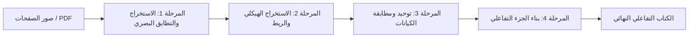

# معمارية خط معالجة وتحويل الكتب (Book Ingestion Pipeline Architecture)

هذا المستند يحدد المعمارية التفصيلية لخط الإنتاج البرمجي المخصص لتحويل أمهات كتب التراث الإسلامي (الممسوحة ضوئياً / PDF) إلى بيانات مهيكلة وتجارب تفاعلية بصرية، بالاعتماد على:
* **واجهات مراجعة مستقلة (Dedicated Review UIs)** لكل مرحلة.
* **مهارات ذكاء اصطناعي وسكربتات مساعدة (AI Skills & Helper Scripts)** متخصصة.
* **نظام الحزم المتتابعة (Batch-Based Human-in-the-Loop)** لضمان الدقة والأمانة العلمية.

---

## 🏛️ المبادئ العامة لسير العمل (Core Principles)

1. **العمل بالحزم (Batch Processing):** معالجة عدد محدد من الصفحات في كل دورة (مثلاً: 10 إلى 20 صفحة)، ولا تنتقل الحزمة للمرحلة التالية إلا بعد الاعتماد البشري.
2. **استقلال المراحل (Staged Separation):** يتم إنجاز المرحلة بالكامل لجميع صفحات الكتاب (أو قسم كامل منه) قبل الانتقال الجماعي للمرحلة التي تليها، لضمان اتساق البيانات.
3. **التكامل بين السكربتات والـ AI Skills:** 
   * **السكربتات (Scripts):** تتولى المهام الحتمية (تقطيع الـ PDF، ضبط الأحجام، التحقق من صحة Schemas، إدارة قواعد البيانات).
   * **مهارات الذكاء الاصطناعي (AI Skills):** تتولى الفهم الدلالي، التعرف البصري، استخراج العلاقات، وحل الالتباس في الأسماء.

---

## 📋 المراحل الأربع التفصيلية

### المرحلة 1: تحويل الصور إلى نصوص وHTML مطابق للشكل (Layout & Text Preservation)

* **الهدف:** استخراج النص الكامل من صفحات الكتاب المصورة مع الحفاظ الدقيق على بنية الصفحة (العناوين، الفقرات، الهوامش، أرقام الصفحات والأسطر).
* **الأدوات المساندة:**
  * `Script: pdf_splitter.py`: تقطيع الكتاب إلى حزم صور عالية الدقة (DPI 300).
  * `AI Skill: vision_layout_extractor`: يحلل الصفحة بصرياً ويستخرج النص مهيكلاً كـ Semantic HTML مع وسوم دلالية ومحددات لمواقع النصوص (`data-page`, `data-line`).
* **واجهة المراجعة (Side-by-Side OCR Reviewer UI):**
  * **الجانب الأيمن:** صورة الصفحة الأصلية بدقة عالية مع إمكانية التكبير والتنقل.
  * **الجانب الأيسر:** محرر HTML الحي مع أدوات تصحيح وتدقيق سريعة بضغطة زر واختصارات لوحة المفاتيح.
  * **زر الاعتماد:** يُغلق الصفحة كـ `Validated HTML` ويحفظها في قاعدة البيانات.

---

### المرحلة 2: استخراج البيانات المهيكلة والربط بالمعرفات الفريدة (Entity Extraction & Text Anchoring)

* **الهدف:** استخراج الكيانات العلمية (رواة، أحكام فقهية، مخارج حروف، شواهد) بصيغة بيانات صارمة (`JSON Schema`)، وتوليد `UUID` فريد لكل كيان، وربطه بموضعه الدقيق في نص الـ HTML من المرحلة الأولى.
* **الأدوات المساندة:**
  * `Script: schema_validator.py`: التحقق البرمجي التلقائي من التزام المخرجات بالـ Schema المطلوبة لكل كتاب.
  * `AI Skill: semantic_entity_parser`: يقرأ نص الـ HTML ويستخرج الكيانات والعلاقات، ويضع وسوم ربط داخل الـ HTML مثل:
    `محمد بن الجزري`.
* **واجهة المراجعة (Entity Tagging & Highlight UI):**
  * عرض النص وتظليل الكيانات المستخرجة بألوان مميزة (مثلاً: أزرق للرواة، أخضر لألفاظ الأداء، برتقالي للأحكام).
  * لوحة جانبية تعرض شجرة البيانات الـ JSON المستخرجة مع إمكانية تعديل الخصائص أو إعادة تعيين حدود النص المظلل.

---

### المرحلة 3: توحيد ومطابقة الكيانات (Global Entity Resolution & Disambiguation)

* **الهدف:** حل مشكلة اختلاف صِيَغ أسماء الرواة والأئمة عبر صفحات الكتاب كاملاً وتوحيدها تحت كيان رسمي واحد (Canonical Entity).
  * *مثال:* دمج ("ابن الجزري"، "محمد بن محمد الجزري"، "أبو الخير"، "شيخ الإقراء") في كيان واحد يحمل `canonical_id` موحد مع الاحتفاظ بالصيغة الأصلية الواردة في كل صفحة.
* **الأدوات المساندة:**
  * `Script: similarity_clusterer.py`: استخدام خوارزميات التشابه اللفظي (Levenshtein) وتضمينات النصوص (Embeddings) لتجميع الأسماء المتشابهة في مجموعات مقترحة للدمج.
  * `AI Skill: biographical_resolver`: يقارن بين السياقات والطبقات الزمنية للتمييز بين المتشابهين (مثل التمييز بين راويين يحملان نفس الاسم في طبقتين مختلفتين).
* **واجهة المراجعة (Entity Merge & Canonical Registry Dashboard):**
  * جدول تجميعي ذكي يعرض الكيان المقترح والأسماء المترادفة التي ذُكر بها مع أرقام الصفحات وروابط العودة لها.
  * واجهة "سحب وإفلات" (Drag & Drop) أو أزرار دمج/فصل بنقرة واحدة لاعتماد الشخصيات الموحدة.

---

### المرحلة 4: بناء الجزء التفاعلي والتطبيق (Interactive Component Prototyping & Generation)

* **الهدف:** تصميم نموذج بصري تفاعلي (Interactive Archetype) ملائم لنوع الكتاب، ثم توليد البيانات التفاعلية للصفحات وتطبيقها برمجياً.
  * *مثال لكتاب النشر:* بناء نموذج الـ Graph وشبكة الأسانيد.
  * *مثال لمتن أبي شجاع:* بناء شجرة القرارات الفقهية المتفرعة.
* **الأدوات المساندة:**
  * `AI Skill: graph_tree_compiler`: يأخذ الكيانات المعتمدة والموحدة (من المرحلتين 2 و 3) ويحولها إلى صيغة الرسوم التفاعلية (Nodes & Edges أو Decision Nodes).
  * `Script: asset_generator.py`: يجمع الأصول الصوتية أو الرسوم التشريحية المساعدة ويتحقق من سلامة مساراتها.
* **واجهة المراجعة (Interactive Split-Screen Preview UI):**
  * بيئة المعاينة النهائية للمستخدم: النص المطابق في جهة، والتفاعل الحي في الجهة المقابلة.
  * أدوات فحص وتفاعل (Debugger) للتأكد من أن النقر على أي عقدة (Node) يحدد موقعها الصحيح في النص الأصلي بسلاسة.

---

## 🗄️ إدارة الحالة وتتبع التقدم (State & Pipeline Orchestration)

لضمان عدم ضياع العمل، يعتمد خط الإنتاج على جدول حالة مركزي (Database / State Ledger):

| رقم الصفحة / الحزمة | حالة المرحلة 1 (HTML) | حالة المرحلة 2 (Extraction) | حالة المرحلة 3 (Resolution) | حالة المرحلة 4 (Interactive) | المدقق البشري |
| :--- | :--- | :--- | :--- | :--- | :--- |
| `batch-001 (pp. 1-15)` | ✅ Approved | ✅ Approved | ⏳ In Review | ⏸️ Pending | د. أحمد |
| `batch-002 (pp. 16-30)` | ✅ Approved | ⏳ In Progress | ⏸️ Pending | ⏸️ Pending | أ. سارة |

---

## 💡 مقترحات إضافية لضمان التفوق

1. **معيار المعرفات (Canonical URIs):**
   * ربط الـ `UUID` الخاص بكل شخصية بمرجع تاريخي معتمد مستقبلاً (مثل رقم الراوي في تراجم كتب الرجال أو أرقام المعجم الدولي الموحد)، مما يتيح إعادة استخدام نفس "شجرة الرواة" في كتب أخرى لاحقاً دون إعادة بنائها من الصفر.
2. **الـ Hotkeys لتسريع التدقيق البشري:**
   * يجب أن تعتمد واجهات المراجعة على لوحة المفاتيح بشكل أساسي (مثلاً: `Ctrl + Enter` للاعتماد، أسهم للتنقل بين العقد) لمضاعفة سرعة الباحثين.
3. **توليد بيانات الاختبار الآلية (Automated Integration Tests):**
   * سكربت يفحص دائماً أن كل `ID` تفاعلي في الشجرة له مقابل دقيق وموجود فعلياً في كود الـ HTML للنص الأصلي قبل السماح بالنشر.
